<div align="center">



<br />

**Full-Stack Developer in Progress** &nbsp;·&nbsp; **React / TypeScript** &nbsp;·&nbsp; **Ruby on Rails** &nbsp;·&nbsp; **Linux**

<sub>Learning in public. Building projects that turn ideas into something useful.</sub>

<br /><br />

[](https://parikesitad-pm.github.io/modula-project-profile/)
[](mailto:parikesit.ad@gmail.com)
[](https://github.com/parikesitad-pm)

</div>

---

### `> whoami`

```ts
const developer = {
  handle: "@parikesitad-pm",
  focus: ["Full-Stack Web", "Backend APIs", "Developer Tools"],
  currentlyLearning: ["Ruby on Rails", "React", "TypeScript"],
  dailyDriver: "Linux + terminal",
  afterHours: "Broadcast streaming & live production",
  philosophy: "Build. Break. Learn. Repeat.",
};
```

I’m a developer who likes bridging thoughtful interfaces and dependable backend systems. I learn through real projects, careful documentation, and plenty of experiments. **MODULA** is the creative identity connecting several of those builds.

### ◈ MODULA projects

<details open>
<summary><b>01 — Forge</b> · AI-assisted thinking companion · Rails + React TS</summary>
<br />

Capture ideas, connect thoughts, and build an evolving personal workspace.

**Stack:** Ruby on Rails · React · TypeScript · Tailwind CSS

[**Source ↗**](https://github.com/parikesitad-pm/forge) · [**Web ↗**](https://frontendreactts.vercel.app)

</details>

<details>
<summary><b>02 — STACK</b> · Markdown-first notes workspace · React TS</summary>
<br />

A local-first Markdown notes workspace, built around focused writing and user-isolated storage.

**Stack:** React · TypeScript · IndexedDB · Auth0 · AWS integrations

[**Source ↗**](https://github.com/parikesitad-pm/stack-react_ts_with_aws_deployment) · [**Web ↗**](https://stack-md.online)

</details>

<details>
<summary><b>03 — untitled</b> · Interactive assessments · React + Firebase</summary>
<br />

Question builders, participant workflows, scores, leaderboards, and data-backed results — an assessment platform under MODULA.

**Stack:** React · TypeScript · Firebase Cloud Functions · Firestore · Cloudinary

[**Frontend ↗**](https://github.com/parikesitad-pm/frontend_untitled_modula_project_react_ts) · [**Backend ↗**](https://github.com/parikesitad-pm/backend_untitled_modula_project_firebase)

</details>

<details>
<summary><b>04 — DOTMOD</b> · Windows environment backup & restore</summary>
<br />

A portable, reproducible workflow for capturing and rebuilding a Windows workstation.

**Stack:** PowerShell · WinGet · Developer toolchains

[**Source ↗**](https://github.com/parikesitad-pm/windows_dotfiles)

</details>

<details>
<summary><b>05 — Afrizal Portfolio</b> · Immersive creative showcase</summary>
<br />

Interactive portfolio with motion, 3D integration, and multilingual content.

**Stack:** React · TypeScript · GSAP · Three.js

[**Source ↗**](https://github.com/parikesitad-pm/ap_branding_react_ts) · [**Web ↗**](https://ap-branding-react-ts.vercel.app)

</details>

<details>
<summary><b>06 — MODULA Base</b> · ERP / POS architecture experiment</summary>
<br />

An earlier experiment exploring multi-tenant business software, POS, stock management, and accounting foundations. *Exploratory / legacy project; not presented as production-ready.*

**Stack:** React · TypeScript · Ruby / Rails

[**Source ↗**](https://github.com/parikesitad-pm/modula_base)

</details>

### ◌ More from the workbench

- [Sena Landing Page](https://github.com/parikesitad-pm/landingpage_sena_reactts) — Personal family landing page made with React & TypeScript.
- [Manjaro GNOME Dotfiles](https://github.com/parikesitad-pm/dotfile_v2) — My Linux development environment configuration.

### ⚙ Tech & tools

<div align="center">

**Frontend**


**Backend & data**


**Daily drivers**


</div>

### ⌘ Quick navigation

<details>
<summary><b>Open developer terminal</b> · click to expand</summary>

```shell
$ whoami
parikesitad-pm

$ cat interests.txt
full-stack web · backend APIs · developer experience · Linux

$ ls modula/
forge/  stack/  untitled/  dotmod/  creative-portfolio/  modula-base/

$ echo $MOTTO
Build. Break. Learn. Repeat.
```

</details>

<details>
<summary><b>How to collaborate</b> · click to expand</summary>

Interested in working together on a backend API, a web product, or a useful open-source tool? Send me an email with a short description of what you're building.

**Email:** [parikesit.ad@gmail.com](mailto:parikesit.ad@gmail.com)

</details>

---

<div align="center">

<sub>crafted with &lt;3 by <a href="https://github.com/parikesitad-pm">parikesitad-pm</a> · a <b>MODULA</b> project</sub>

</div>

### 🌐 Interactive portfolio

**[Open the interactive MODULA profile →](https://parikesitad-pm.github.io/modula-project-profile/)** — JavaScript animation, command palette, project filters, and detailed project showcase.

[Website source repository](https://github.com/parikesitad-pm/modula-project-profile). JavaScript runs on GitHub Pages, while the README above uses GitHub-supported Markdown, SVG and expandable sections.

