<div align="center">

  <a href="https://parikesitad-pm.github.io/modula-project-profile/">
    <picture>
      <source media="(max-width: 767px)" srcset="./assets/hero-mobile.svg" />
      
    </picture>
  </a>

  <p><strong>Hey, I'm Dap.</strong></p>
  <p><strong>Full-Stack Developer in Progress</strong> · <strong>Shell Enthusiast</strong> · <strong>Desktop Tools Builder</strong></p>
  <p><sub>React / TypeScript · Ruby on Rails · Zsh / Bash / PowerShell 7 · Python / CustomTkinter · vMix / OBS Studio</sub></p>

  <p>
    <a href="https://parikesitad-pm.github.io/modula-project-profile/"></a>
    <a href="mailto:parikesit.ad@gmail.com"></a>
    <a href="https://github.com/parikesitad-pm"></a>
  </p>

</div>

---

### `> whoami`

```ts
const dap = {
  handle: "@parikesitad-pm",
  mindset: "Build. Break. Learn. Repeat.",
  building: ["Web Products", "Backend APIs", "Developer Tools"],
  shells: ["Zsh", "Bash", "PowerShell 7"],
  toolbox: ["Starship", "fzf", "zoxide", "eza", "bat"],
  exploring: ["React + TypeScript", "Ruby on Rails", "Python / CustomTkinter"],
  outsideCode: "Broadcast streaming & live production",
  creativeIdentity: "a MODULA project",
};
```

I enjoy turning ideas into useful products, from thoughtful React interfaces to APIs, shell automation, and desktop applications. I'm especially at home in a terminal: dotfiles, prompt themes, fast navigation, and scripts that make repeated work disappear.

### 🔴 MODULA / core ecosystem

The main product builds and foundations under **MODULA** — separate projects, connected by the same curiosity.

| Project | What I'm building | Stack / stage |
| --- | --- | --- |
| **[Forge](https://github.com/parikesitad-pm/forge)** | A thinking companion for capturing sparks and growing ideas. [Explore live ↗](https://frontendreactts.vercel.app) | Rails · React TS · evolving |
| **[STACK](https://github.com/parikesitad-pm/stack-react_ts_with_aws_deployment)** | A Markdown-first, local-first notes workspace. [Explore live ↗](https://stack-md.online) | React TS · IndexedDB · Auth0 |
| **[untitled](https://github.com/parikesitad-pm/frontend_untitled_modula_project_react_ts)** | Activity builder, assessments, participants, leaderboard and results. [Backend ↗](https://github.com/parikesitad-pm/backend_untitled_modula_project_firebase) | React TS · Firebase |
| **[POINT by MODULA](https://github.com/parikesitad-pm/point_by_modula_project_frontend)** | Point-of-sale & business operations UI, including owner dashboard and cashier terminal. | React 19 · TS · Tailwind v4 · frontend/mock-stage |
| **[MODULA Base](https://github.com/parikesitad-pm/modula_base)** | Earlier experiments in ERP, POS, inventory and accounting foundations. | Ruby · React TS · legacy architecture exploration |

> **Product status matters:** POINT's repository documents a mock frontend evaluation, not a verified deployed payment system. MODULA Base is an earlier experimental foundation, not a production-ready enterprise product.

### ⚡ Shell / automation / desktop

This is my other favorite workshop: the command line, reproducible workstations, and tools that run outside the browser.

| Project | What it does |
| --- | --- |
| **[DOTMOD](https://github.com/parikesitad-pm/windows_dotfiles)** | PowerShell-based Windows environment backup and restoration |
| **[AutoFailover](https://github.com/parikesitad-pm/smart_auto_failover)** | Python + CustomTkinter desktop application for managing network failover during live workloads |
| **[Manjaro Dotfiles](https://github.com/parikesitad-pm/dotfile_v2)** | Bash/Zsh setup, Kitty terminal, Starship, dev tooling and workstation bootstrap |
| **[Gundam Celestial GNOME](https://github.com/parikesitad-pm/gundam-celestial-gnome-theme)** | Declarative Linux desktop configuration powered by Shell scripts |
| **[Gundam Glass XFCE](https://github.com/parikesitad-pm/xfce_themed)** | Automated XFCE setup, customization and desktop scripts |

### 🎨 Creative work & other builds

**[Afrizal Pramudyan Portfolio](https://github.com/parikesitad-pm/ap_branding_react_ts)** — an interactive React / TypeScript portfolio with GSAP, Three.js, and multilingual content. [Visit ↗](https://ap-branding-react-ts.vercel.app)

**[Sena Landing Page](https://github.com/parikesitad-pm/landingpage_sena_reactts)** — a personal family landing page built with React and TypeScript.

### 🛠 Languages & tools

<div align="center">
  <p><strong>Web development</strong></p>
  <p></p>
  <p><strong>Shell, desktop & systems</strong></p>
  <p></p>
  <p><code>Zsh · Starship · Kitty · fzf · zoxide · eza · bat · CustomTkinter</code></p>
</div>

### `$ ls ~/modula`

<details>
<summary><b>Open the terminal</b> — expand to see my favorite workflow</summary>

```shell
$ whoami
Dap (@parikesitad-pm)

$ echo "$SHELL"
/bin/zsh

$ ls ~/modula
forge/  stack/  untitled/  point/  modula-base/

$ ls ~/workbench
dotmod/  autofailover/  dotfiles/  gundam-gnome/  xfce/

$ git status --short
# always building, always learning
```

</details>

<details>
<summary><b>Interested in collaborating?</b></summary>

I'm interested in backend APIs, full-stack web projects, terminal tooling, desktop utility applications and practical open-source projects.

Get in touch: **[parikesit.ad@gmail.com](mailto:parikesit.ad@gmail.com)**.

</details>

---

<div align="center">
  <p><strong><a href="https://parikesitad-pm.github.io/modula-project-profile/">OPEN THE INTERACTIVE MODULA PROJECT EXPLORER ↗</a></strong></p>
  <p><sub>crafted with &lt;3 by <a href="https://github.com/parikesitad-pm">parikesitad-pm</a> · <strong>a MODULA project</strong></sub></p>
</div>

<!-- GitHub profile READMEs do not execute JavaScript. The interactive site is deployed separately through GitHub Pages. -->
